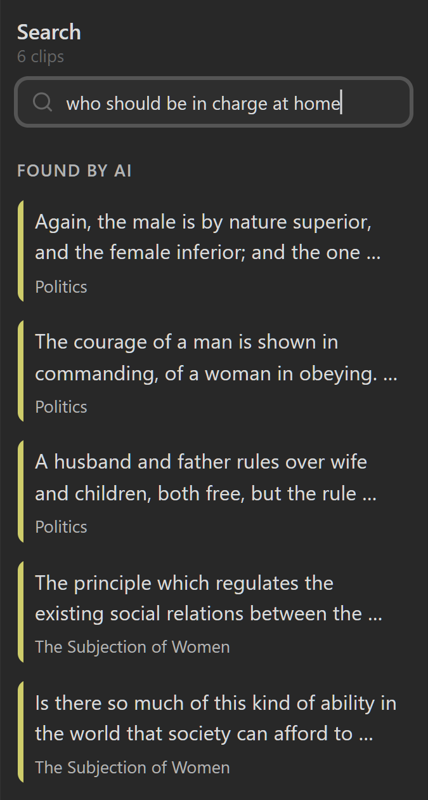
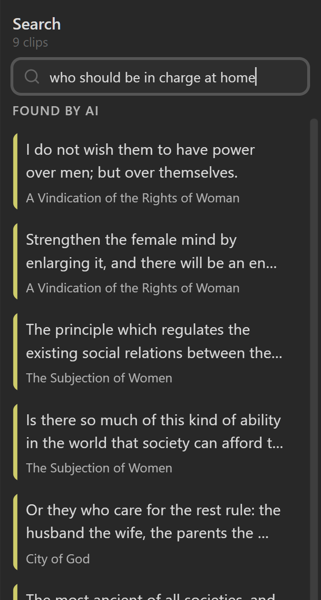
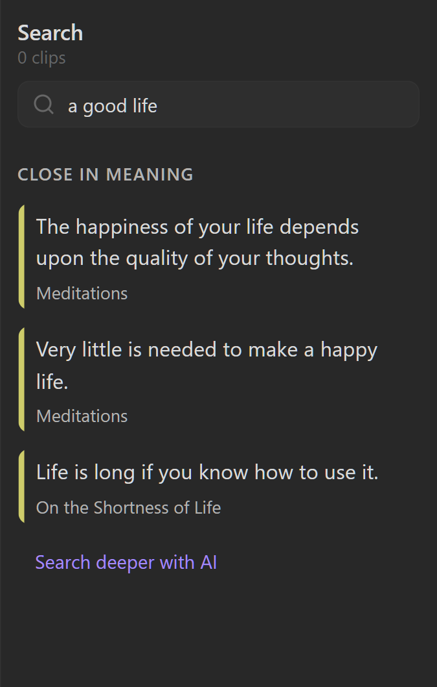
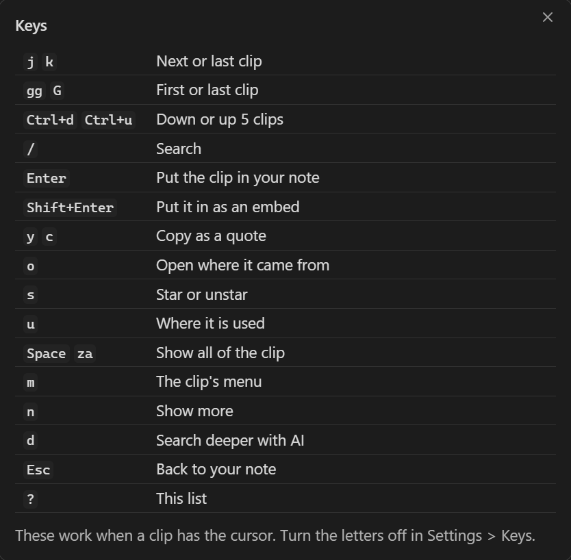
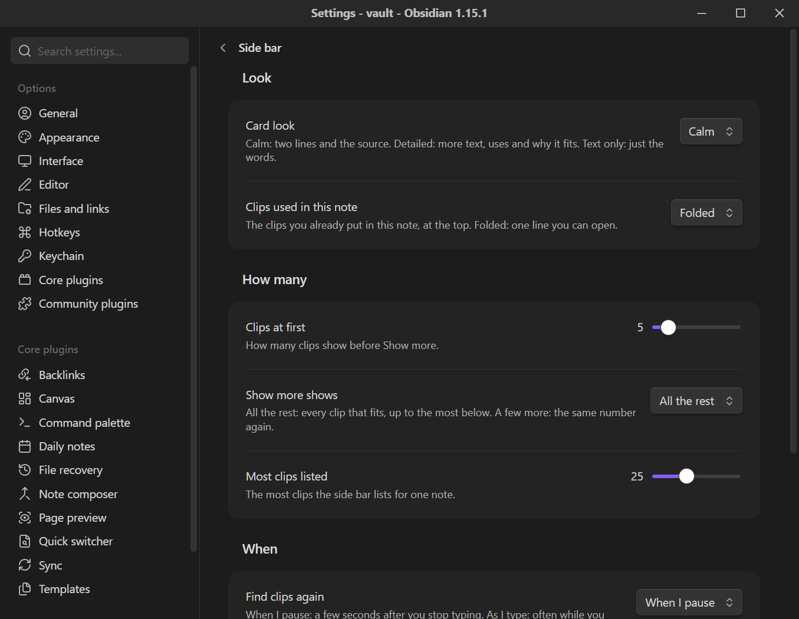
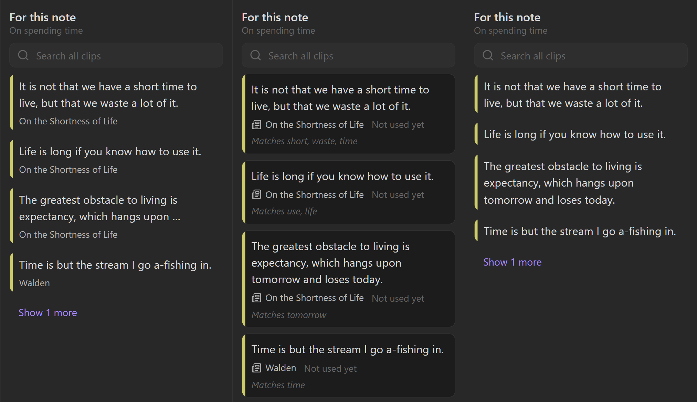
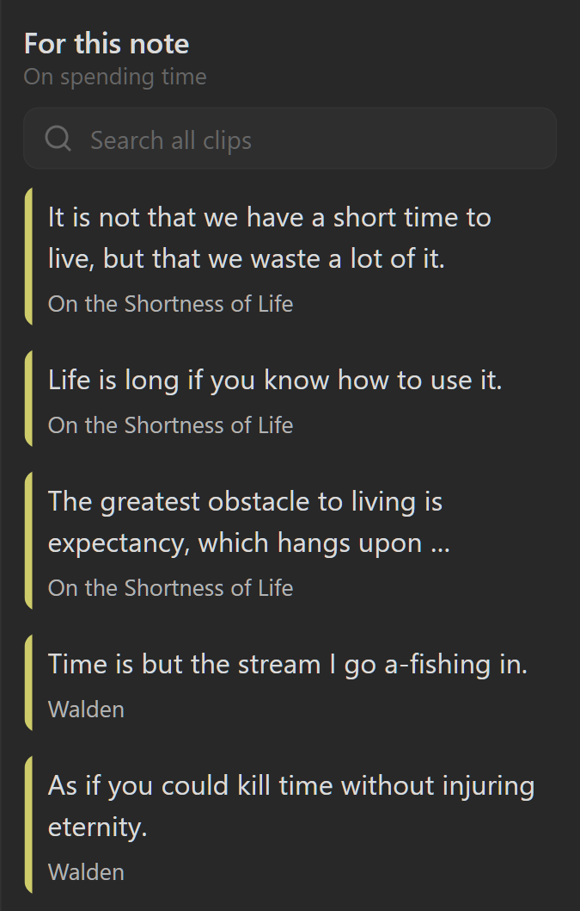
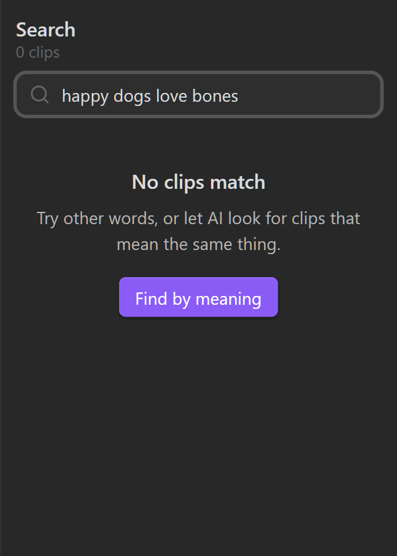
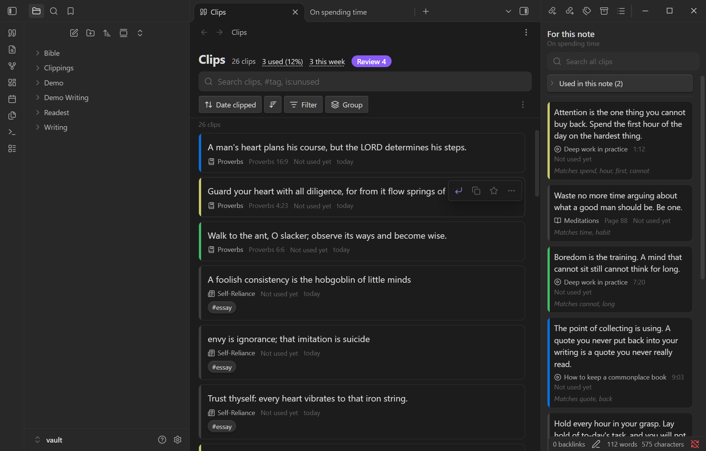

# What's new

## 0.9.3 (25 Nov 2026)

**Search deeper with AI reads every clip.**

- Before, AI saw only 60 clips that this device picked. In a big library, the right clip was often not one of them.
- Now AI skims every clip, then reads the ones that may fit and scores each one. Only clear fits show, best first.
- Fewer clips that only share a word with your search.
- Your own note on a clip helps AI find it.
- About 35 tokens a clip, so about 25,000 tokens a search for 700 clips. The same search again costs nothing.
- To use fewer tokens: **Settings → AI → Search deeper reads → Likely clips**.

## 0.9.2 (25 Nov 2026)

**Search deeper with AI finds much more, and Enter can start it.**

- AI now looks for the topic behind your search, not only its words. "Who should be in charge at home" finds quotes about husbands, wives and who rules, for it and against it.
- AI reads more of your clips. A small library goes to AI whole. The best fits come first.
- In a test with 68 book quotes and 12 searches, AI found 78% of the right clips. Before, it found 39%.
- New setting: **Enter searches deeper** (Settings → AI). Press Enter in a search, and the list moves to what AI finds. No scrolling.
- New command: **Search deeper with AI**. Give it any key in Settings → Hotkeys.
- About 1,500 tokens for each 30 clips. The same search again costs nothing.

## 0.9.1 (22 Nov 2026)

**Search deeper with AI finds the right clips.**

- AI now reads your likely clips and keeps only the ones that fit. Before, AI only gave other words, so clips that shared a word showed up too.
- Search the way you remember it, even if you remember it wrong: "a philosopher said to marry around 30" finds Aristotle's quote about marrying at thirty-seven.
- AI sees where each clip is from, so "a philosopher" or a book name helps.
- About 1,500 tokens for each search. The same search again costs nothing.
- The count under Search now counts every clip shown.

## 0.9.0 (22 Nov 2026)

**Vim keys.** Use Clips without the mouse.

- In the side bar and the library: `j` `k` move, `gg` `G` go to the first and last clip, `Ctrl+d` `Ctrl+u` move 5.
- On a clip: `Enter` puts it in, `y` copies, `m` opens the menu, `Space` shows all of it.
- `n` shows more. `d` searches deeper with AI. `/` searches. `Esc` goes back to your note.
- In search, `Enter` or `Esc` goes to the first clip.
- `?` shows every key. Turn the letters off in **Settings → Keys**.
- The cursor stays on your clip when the list changes, for example after you star it.

## 0.8.3 (22 Nov 2026)

**Search deeper with AI, under any search.**

- **Search deeper with AI** now shows under the results too, not only when nothing is found. In the side bar and the library.
- AI's finds show after your results, under **Found by AI**, with no repeats.
- AI is still asked only when you press it.

## 0.8.2 (22 Nov 2026)

**Search deeper with AI.**

- When nothing matches and nothing is close in meaning, press **Search deeper with AI**. It shows in the side bar and the library when AI is set up.
- AI gives other words for your search. Clips finds your clips with those words, and with meaning search too.
- AI is asked only when you press the button.

## 0.8.1 (22 Nov 2026)

**Meaning search is lighter.**

- **Half the size.** The model downloads 15 MB once and keeps 4 MB. The top results are almost the same.
- **Nothing loads until you need it.** The model loads the first time you search or the side bar needs it. A phone gets it then too.
- **Less memory.** Each clip's meaning takes 128 bytes.
- **Off frees the memory at once.** A model from 0.8.0 is deleted by itself.

## 0.8.0 (22 Nov 2026)

**Meaning search, with no AI app.**

- **Find clips by meaning on this device.** A search for "terrified" also finds a clip about fear. No AI app, no key, no cost. Ollama does not have to run.
- **Get it once.** Press **Find by meaning** on an empty search, or **Settings → Clips → Meaning search → Get the meaning model**. It downloads 30 MB once and keeps 8 MB.
- **In search and in the side bar.** Clips close in meaning show under the matches. **For this note** also lists clips close in meaning. AI is not asked when meaning search is on.
- **New clips are found by meaning at once.**
- **Your phone too.** A phone or computer that syncs your settings gets the model by itself. Turn off **Get it on other devices** to stop that.
- **Everything is a setting**: in search, in the side bar, and how close (Close, Some or Loose).

## 0.7.0 (22 Nov 2026)

**Set it up your way.**

- **Show more shows all the rest.** Or pick **A few more** in **Settings → Clips → Side bar**.
- **Find clips again**: when you pause typing, as you type, or only when you open another note.
- **Clips used in this note**: folded, open or hidden.
- **Clips for drawings**: off by default, on if you want them.
- **Library look**: Full, Compact or Text only, in **Settings → Clips → Library**.
- **Hide clip ids in the editor**: on by default, in **Putting clips in**.
- **Sort the side bar** with AI is now its own switch, in **AI**.

## 0.6.0 (22 Nov 2026)

**Pick the side bar's look.**

- **Three looks** in **Settings → Clips → Side bar → Look**. Calm: two lines and the source. Detailed: more text, how often it is used, and why it fits. Text only: just the words.
- **Clips at first**: how many clips show before Show more, from 3 to 20.

## 0.5.0 (22 Nov 2026)

**A calm side bar.**

- **Only the 5 best clips** for your note. **Show 5 more** gives more.
- **Each clip is two lines** and one small source line. Its buttons show when you point at it, or tap it on a phone.
- **It does not change while you type.** It updates when you stop for a few seconds, or open another note.
- **No clips for drawings.** Search still works there.

## 0.4.0 (22 Nov 2026)

**Find by meaning when nothing matches.**

- **Find by meaning.** When a search in the side bar or the library finds nothing, press **Find by meaning**. AI looks for clips that mean the same thing in other words. Without AI, the button sets it up.
- **Search in side bar.** This command puts the cursor in the side bar's search, even while you write in a note. Escape goes back to your note. It replaces Show for this note.
- **Whole vault works everywhere.** With no folders, the library and side bar showed "No clip folders yet". They now show your clips.

## 0.3.0 (22 Nov 2026)

**No folders needed.**

- **Use your whole vault.** Every note with highlights counts, wherever it is. Choose it in setup, or in **Settings → Clips → Where clips are**. You can still pick folders instead.
- **A clip you put in as a quote is a use**, never a second copy of the clip.

## 0.2.0 (22 Nov 2026)

**AI on your own device, and four strong commands.**

**New name: Clips.** It was Obsi Clips. The new plugin id is `clips`.

- **Set up AI in one window.** It finds the models on this computer by itself: Ollama, LM Studio, Jan, GPT4All and llama.cpp. Press Use. Each choice is tested before it is saved.
- **Use the AI model in an Obsi app on your phone.** On Android, link to ObsiTube, ObsiRead, ObsiLearn or Obsi Bible. The app asks you first. Nothing leaves the phone.
- **Many more services.** OpenRouter, Anthropic, OpenAI, Google Gemini, Groq, Mistral, DeepSeek and xAI. **Pick** shows the service's own models, small and fast first, with prices.
- **A model on another computer in your home.** Type its address and press Look.
- **Safer keys.** A key is sent only over https or to this device. Remove AI from this device deletes it.
- **Four commands.** Put a clip in, Open library, Show for this note, Review. In the command list each one starts with "Clips:". Each one does more: with text selected, Put a clip in finds clips like it and puts the clip after your text. With no search, the clips that fit your note come first.
- **Review never stops early.** When today's clips are done, Review gives you a few more.
- Thinking models in Ollama, like qwen3, now answer instead of thinking until they run out of words.

## 0.1.0 (21 Nov 2026)

**The first version.** Clips reads the highlights in your clip folders: ObsiTube, ObsiRead, ObsiLearn, Obsi Bible, Readest, the Web Clipper and any ==marked== text.

- **Clips for this note.** A side bar shows the clips that fit the note you are writing. Tap to put one in, or drag it in.
- **Times used.** Each clip shows how often it is used and where. Clip notes show "Used 3×" after each used clip.
- **The library.** Every clip in one place. Search, sort, reverse, filter by type, colour, use, tag, source or date, and group.
- **Review.** A few clips you have not used yet, each day. Put one in a note, keep it for later, star it or archive it.
- **Tidy.** Find clips saved twice, near copies, clips with no tags and broken clip links.
- **Optional AI.** Finds clips close in meaning and suggests tags. Off until you set it up.
