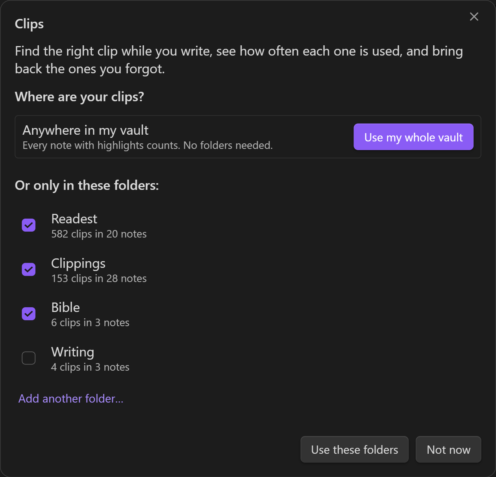
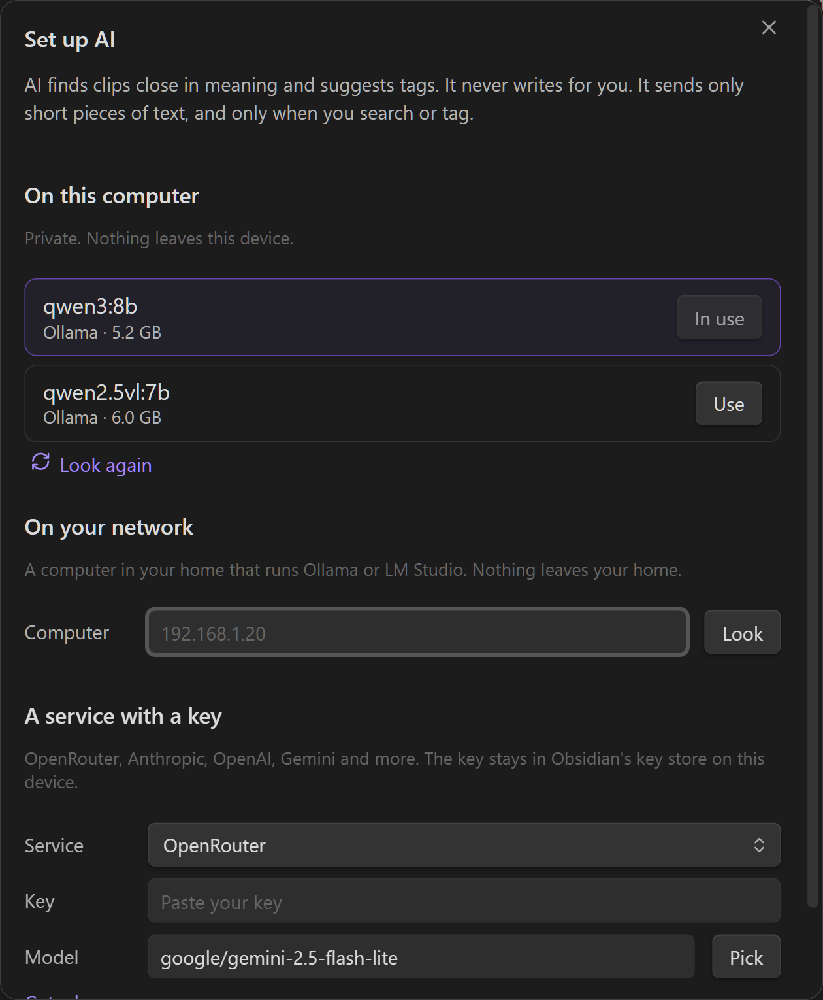

# What's new

## 0.4.0 (22 Nov 2026)

**Find by meaning when nothing matches.**

- **Find by meaning.** When a search in the side bar or the library finds nothing, press **Find by meaning**. AI looks for clips that mean the same thing in other words. Without AI, the button sets it up.
- **Search in side bar.** This command puts the cursor in the side bar's search, even while you write in a note. Escape goes back to your note. It replaces Show for this note.
- **Whole vault works everywhere.** With no folders, the library and side bar showed "No clip folders yet". They now show your clips.

## 0.3.0 (22 Nov 2026)

**No folders needed.**

- **Use your whole vault.** Every note with highlights counts, wherever it is. Choose it in setup, or in **Settings → Clips → Where clips are**. You can still pick folders instead.
- **A clip you put in as a quote is a use**, never a second copy of the clip.

## 0.2.0 (22 Nov 2026)

**AI on your own device, and four strong commands.**

**New name: Clips.** It was Obsi Clips. The new plugin id is `clips`.

- **Set up AI in one window.** It finds the models on this computer by itself: Ollama, LM Studio, Jan, GPT4All and llama.cpp. Press Use. Each choice is tested before it is saved.
- **Use the AI model in an Obsi app on your phone.** On Android, link to ObsiTube, ObsiRead, ObsiLearn or Obsi Bible. The app asks you first. Nothing leaves the phone.
- **Many more services.** OpenRouter, Anthropic, OpenAI, Google Gemini, Groq, Mistral, DeepSeek and xAI. **Pick** shows the service's own models, small and fast first, with prices.
- **A model on another computer in your home.** Type its address and press Look.
- **Safer keys.** A key is sent only over https or to this device. Remove AI from this device deletes it.
- **Four commands.** Put a clip in, Open library, Show for this note, Review. In the command list each one starts with "Clips:". Each one does more: with text selected, Put a clip in finds clips like it and puts the clip after your text. With no search, the clips that fit your note come first.
- **Review never stops early.** When today's clips are done, Review gives you a few more.
- Thinking models in Ollama, like qwen3, now answer instead of thinking until they run out of words.

## 0.1.0 (21 Nov 2026)

**The first version.** Clips reads the highlights in your clip folders: ObsiTube, ObsiRead, ObsiLearn, Obsi Bible, Readest, the Web Clipper and any ==marked== text.

- **Clips for this note.** A side bar shows the clips that fit the note you are writing. Tap to put one in, or drag it in.
- **Times used.** Each clip shows how often it is used and where. Clip notes show "Used 3×" after each used clip.
- **The library.** Every clip in one place. Search, sort, reverse, filter by type, colour, use, tag, source or date, and group.
- **Review.** A few clips you have not used yet, each day. Put one in a note, keep it for later, star it or archive it.
- **Tidy.** Find clips saved twice, near copies, clips with no tags and broken clip links.
- **Optional AI.** Finds clips close in meaning and suggests tags. Off until you set it up.
