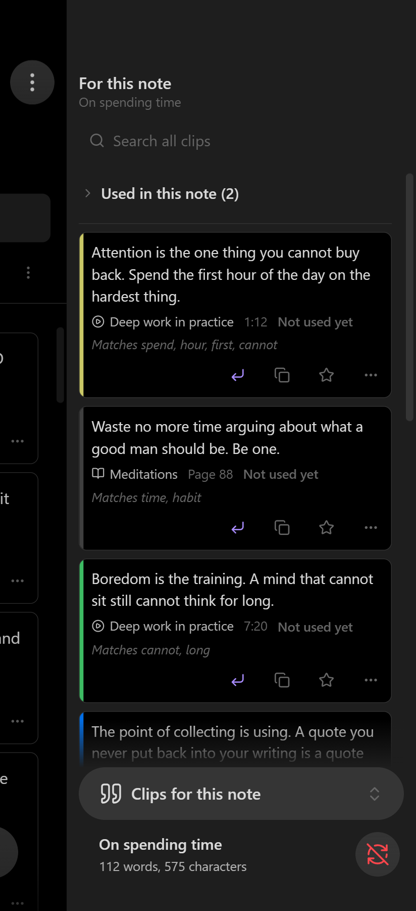
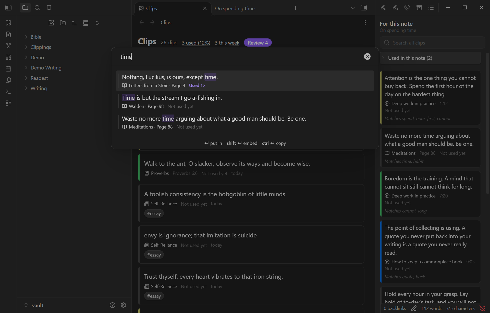
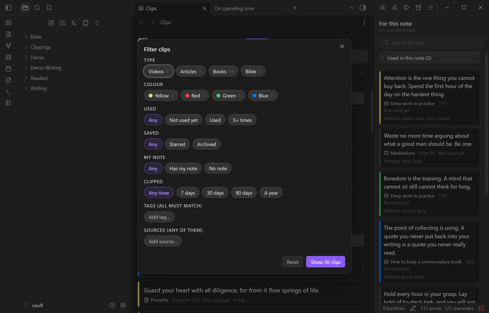
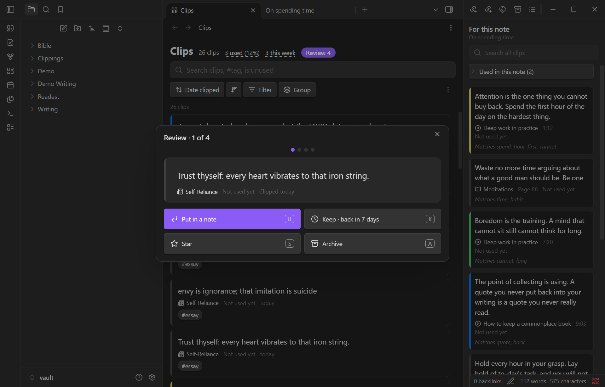
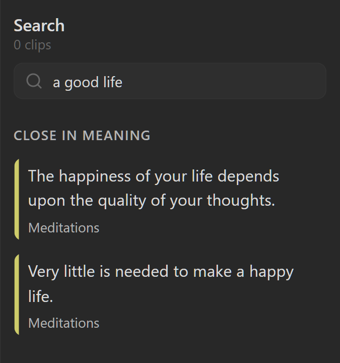
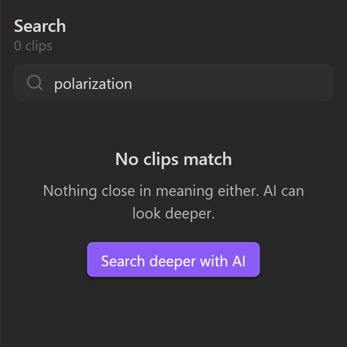
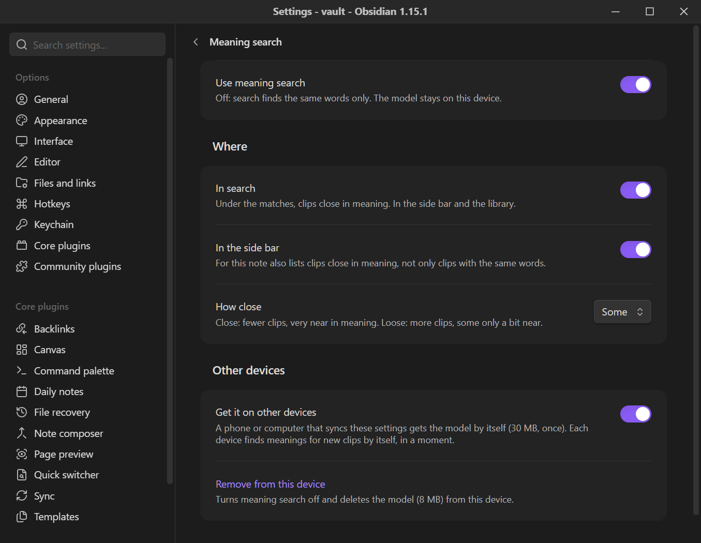

# Clips

Use the clips you save. Clips reads the highlights in your vault and puts the right ones next to the note you are writing. It counts how often you use each clip and where. Each day it brings back a few clips you forgot.

Clips is part of the Obsi apps. It works with the clips from ObsiTube, ObsiRead, ObsiLearn, Obsi Bible, Readest, the Obsidian Web Clipper and any `==marked==` text. It works on desktop, phones and tablets.


## Start

1. Install and turn on the plugin.
2. A short setup asks where your clips are. Press **Use my whole vault** if you do not use folders: every note with highlights counts. Or tick the folders that hold clips and press **Use these folders**. It shows how many clips each folder has.
3. The library opens. The side bar on the right shows **Clips for this note**.

You can change this at any time in **Settings → Clips → Where clips are**.

### On a phone or tablet

1. Install the plugin from **Settings → Community plugins** on the phone, or sync the plugin folder from your computer.
2. The same setup opens on first start.
3. Open the library from the ribbon (the quote icon) or the command palette.
4. **Clips for this note** sits in the right side bar. Swipe from the right edge to open it.

All buttons on a phone are big enough to tap. Card buttons are always visible, not only on hover.

## Commands

Four commands, so they are easy to put on keys. Set keys in **Settings → Hotkeys**: search for "Clips".

| Command | What it does |
|---|---|
| **Put a clip in** | Opens the clip picker. The clips that fit your note come first. With text selected, it searches for clips like that text and puts the clip after it. With no note open, it asks which note. |
| **Open library** | Opens the library, or goes to it, with the cursor in its search. |
| **Search in side bar** | Opens the side bar with the cursor in its search, even while you write in a note. Escape clears the search, and Escape again goes back to your note. |
| **Review** | Today's clips. When they are done, a few more. |

Everything else is in the library's **⋯** menu, the right-click menu in a note, and Settings.

## What it does

### Clips for this note

The side bar reads the note you are writing and shows the 5 clips that fit it best. Press **Show all** to see the rest. Each clip is two lines and its source. It does not change while you type: it updates when you stop for a few seconds. Clips you already used in this note are in their own list at the top. Drawings get no clips.

Pick the look in **Settings → Clips → Side bar → Look**: **Calm** (two lines and the source), **Detailed** (more text, uses, and why it fits) or **Text only** (just the words). **Clips at first** sets how many show before Show more.

- Tap the arrow to put a clip in at the cursor.
- On desktop, drag a clip into the note.
- Type in the search box to look through all clips.

When the open note is a clip note (a book, video or article), the side bar shows the clips in that note instead.



### Put a clip in

Run **Put a clip in**, or right-click in a note and pick **Put a clip here**. Before you type, the clips that fit your note are at the top. Type a few letters to search: exact words come first, then the start of words, then small typos.

Select some text first to find clips like it. The picker searches with its two strongest words, and the clip goes in after your text, never over it.

- **Enter** puts it in as a quote with a link back to where it came from.
- **Shift+Enter** puts it in as an embed, so it stays linked to the clip.
- **Ctrl+Enter** (Cmd on a Mac) copies it.

A quote looks like this:

```markdown
> [!quote] [[Letters from a Stoic]] · Page 4
> Nothing, Lucilius, is ours, except time.
```

For a video clip, the time is a link that opens the video at that second.



### Times used

Each clip shows how often it is used: **Used 2×**. Tap it to see each note that uses it and open one.

A clip counts as used when a note:

- embeds it (`![[Book#^clip-abc123]]`),
- links to its block (`[[Book#^clip-abc123]]`), or
- has the clip text pasted in (turn this off in **Counting uses**).

A clip's own note never counts as a use of it. With folders, notes inside your clip folders do not count either, so two books that share a quote do not count as uses of each other. A clip you put in as a quote is a use, never a second copy of the clip. Add more folders to ignore, like templates, in **Counting uses**.

In your clip notes, each used clip shows a small **Used 3×** at its end, in both editing and reading view. Turn it off in **Counting uses**.

### The library

Every clip in one place.

- **Search** with words, `#tag`, `is:unused`, `is:used`, `is:starred`, `is:archived`, `is:noted`, `color:green` or `type:book`.
- **Sort** by best match, date clipped, times used, last used, source, length, colour or shuffle.
- **Reverse** any sort with the arrow button next to it.
- **Filter** by type, colour, used or not, starred or archived, has your note, date clipped, tags and sources. The button shows how many clips match before you close it. Each filter shows as a chip you can remove. **Clear all** removes them all.
- **Group** by source, type, tag, month clipped, colour or used or not. Tap a group to fold it.
- **Select** many clips to star, tag, copy or archive them together.
- The numbers at the top are buttons: **9 used** shows the used clips, **3 this week** shows the new ones.

The library remembers your search, sort and filters.

### Vim keys

Use Clips without the mouse, in the side bar and the library. On by default. Turn them off in **Settings → Keys**. Arrow keys always work.

| Key | What it does |
| --- | --- |
| `j` `k` | Next or last clip |
| `gg` `G` | First or last clip |
| `Ctrl+d` `Ctrl+u` | Down or up 5 clips |
| `/` | Search |
| `Enter` | In search: go to the first clip. On a clip: put it in your note |
| `Shift+Enter` | Put it in as an embed |
| `y` `c` | Copy as a quote |
| `o` | Open where it came from |
| `s` | Star or unstar |
| `u` | Where it is used |
| `Space` `za` | Show all of the clip |
| `m` | The clip's menu |
| `n` | Show more |
| `d` | Search deeper with AI |
| `Esc` | In search: go to the first clip. On a clip: back to your note |
| `?` | The list of keys |


To open Clips from a note with Vim, add this to your `.obsidian.vimrc` (needs the Vimrc Support plugin). Then `Space` `c` opens the side bar search:

```
exmap clips obcommand clips:open-panel
nmap <Space>c :clips<CR>
```




### Review

Each day, a few clips you have not used yet. Clips that were never shown come first.

- **Put in a note** (`U`) asks which note, then puts it there.
- **Keep** (`K`) brings it back later: in 7 days, then 21, 60 and 180.
- **Star** (`S`) and **Archive** (`A`).

When today's clips are done, **Review** gives you a few more. The status bar shows how many are left. A short notice reminds you once a day. Turn both off in **Review**.



### Tidy

Open **Tidy clips** from the library's **⋯** menu, or from Settings, to find:

- **In two notes**: the same words saved twice. They count as one clip.
- **Near copies**: clips that say almost the same thing.
- **No tags**: clips with no tags. Add tags here.
- **Broken links**: embeds and links that point to a clip that is gone.

Tidy never changes your notes by itself. It shows you the clip and opens the note.

## Clip formats it reads

| From | What it looks like |
|---|---|
| ObsiTube, ObsiLearn | A `>` quote with a marked line and a time link under it |
| ObsiRead | A `>` quote with a marked line and a link to the article |
| Obsi Bible | A `### Book 4:23 · BSB · Yellow` heading with a `>` quote |
| Readest | A list item with the highlight and `*page 12*`, and an optional `**Note:**` |
| Web Clipper and others | Any `==marked==` text inside a paragraph or a quote |

Plain `>` quotes with no marks can count too. Turn on **Plain quotes count** in **Where clips are**.

Your own note under a clip (the paragraph after an ObsiTube or ObsiRead quote, or Readest's **Note:**) shows under the clip.

## Meaning search

Finds clips that mean the same thing in other words. A search for "terrified" also finds a clip about fear. It runs on your device, with no AI app, no key and no cost.



- **Get it once.** Press **Find by meaning** when a search finds nothing, or open **Settings → Clips → Meaning search → Get the meaning model**. It downloads a small model once (15 MB, from Hugging Face) and keeps 4 MB in the plugin folder.
- **In search.** Clips close in meaning show under the matches, in the side bar and the library.
- **In the side bar.** **For this note** also lists clips close in meaning, not only clips with the same words.
- **New clips** are found by meaning as soon as they come in.
- **Light.** Nothing loads until you search or the side bar needs it. Each clip's meaning takes 128 bytes. Turning it off frees the memory.
- **On every device.** A phone or computer that syncs your settings gets the model by itself, the first time it needs it. Each device finds meanings for its clips in a moment. Turn off **Get it on other devices** to stop that.
- **How close**: Close shows fewer clips, very near in meaning. Loose shows more.
- **Search deeper with AI.** With AI set up, **Search deeper with AI** shows under the results, or as a button when nothing is found. Clips gathers about 36 likely clips, and AI reads them with where each is from and keeps only the ones that fit. Search the way you remember it, even if you remember it wrong. AI's finds show under **Found by AI**. About 1,500 tokens for each search, and AI is asked only when you press it.



The model is [potion-base-4M](https://huggingface.co/minishlab/potion-base-4M) by Minish Lab (MIT licence). It works best on words and short phrases. It does not understand a whole sentence the way a chat AI does.



## AI (optional)

AI is off until you set it up. Everything above works without it.

When it is on, it does two small things:

- **Close in meaning.** Search and **Clips for this note** also find clips that mean the same thing with other words. These come after the exact matches, under their own heading. With **Meaning search** on, it does this instead and AI is not asked.
- **Tag ideas.** In a clip's tags, it suggests tags. It reuses your own tags where it can.

When a search finds nothing, press **Find by meaning**. AI looks for clips that mean the same thing in other words. This works even with **Find by meaning** turned off in Settings, because you asked.

It never writes text for you.

### Set it up

Open **Settings → Clips → AI → Set up AI**. One window shows every choice:

1. **On this computer.** It looks for model apps that are running: Ollama, LM Studio, Jan, GPT4All and llama.cpp. Each model they have is listed, smallest first. Small models are fast and enough. Press **Use**.
2. **On this phone (Android).** Pick **Model in an Obsi app** and press **Link**. ObsiTube, ObsiRead, ObsiLearn or Obsi Bible opens and asks if Clips may use its AI model. Press **Allow**. You come back to Obsidian, linked. If the app has no model yet, it says so: get one in that app's **Settings → AI**.
3. **On your network.** A computer in your home that runs Ollama or LM Studio. Type its address, like `192.168.1.20`, and press **Look**. In Ollama, turn on **Expose Ollama to the network**. In LM Studio, turn on **Serve on Local Network**.
4. **A service with a key.** OpenRouter, Anthropic, OpenAI, Google Gemini, Groq, Mistral, DeepSeek, xAI, or any OpenAI-style service. Pick the service and press **Get a key** if you need one. Paste the key. A small, fast model is filled in. Press **Pick** to choose another from the service's own list: the small, fast ones come first, with their price. Then press **Use this service**.

One small, fast model is enough for everything here. Each job asks for a very short answer, so a big model only costs more and is slower. Models that think before they answer are put last in **Pick**, because they use many more tokens.

Each choice is tested before it is saved. If the test fails, nothing changes, and the window says why.

No model app yet? [Ollama](https://ollama.com) and [LM Studio](https://lmstudio.ai) are free. Install one, get a small model, then press **Look again**.

### How it is kept safe

- **Models on your device stay on your device.** Clips looks for them only at `127.0.0.1`, this device's own address.
- **Keys stay out of your vault.** A key is kept in Obsidian's key store on this device. It is never in the plugin's `data.json`, so it never goes into your vault or your sync. **Remove AI from this device** deletes it.
- **A key is sent only over https,** so it cannot be read on the way. The only exception is this device itself. A plain `http` address is allowed only on this device or your home network, and never with a key.
- **The phone link asks first.** The Obsi app shows who is asking and waits for **Allow**. It listens only on `127.0.0.1`, so nothing off the phone can reach it. Every request needs the link key. Web pages are refused. The app keeps only a scrambled copy of the key, and you can remove the link in the app's **Settings → AI**. The link is accepted only if it answers a request Clips made in the last ten minutes.
- **Little is sent.** Only short pieces go out: a clip's text, or the first part of the note you are writing. Each answer is capped at a few dozen tokens. Results are kept, so the same question is never asked twice.

While Obsidian may use the phone's model, the Obsi app shows a small notification. It stops by itself after 20 minutes unused, and starts again when you open the app.

## Things to know

- **Embeds add a block id.** Putting a clip in as an embed adds a short id like `^clip-abc123` to the end of that clip in its note. If an app writes that note again from scratch, it can remove the id and the embed breaks. Obsi Bible notes are written over by the app, so Clips puts Bible clips in as quotes, not embeds. **Tidy → Broken links** finds any embed that broke.
- **The plugin never changes your clip notes**, except to add that block id when you choose an embed.
- **No work in the background.** The first count reads your notes once, then keeps the result. After that, only a note you change is read again. **Count uses again** (in the library's **⋯** menu) reads every note again if a count ever looks wrong.
- Star, archive, review and tags you add in the plugin are kept in the plugin's own data. Tags in your notes stay in your notes.

## Settings

- **Library**: Full, Compact or Text only cards.
- **Side bar**: card look, clips used in this note, clips at first, what Show more shows, the most clips listed, when it finds clips again, clips for drawings, and open on start.
- **Where clips are**: the whole vault or only some folders, marked text, plain quotes, and the shortest clip to count.
- **Putting clips in**: quote, embed or plain text, the callout type, and whether to add your note and where it came from.
- **Counting uses**: pasted text counts or not, folders to ignore, and the **Used 3×** marks.
- **Review**: how many clips a day, the daily notice and the status bar.
- **Meaning search**: get or remove the model, in search, in the side bar, how close, and other devices.
- **AI**: set up, change or remove AI, find by meaning, and tag ideas. See above.

## Install by hand

Download `main.js`, `manifest.json` and `styles.css` from the [latest release](https://github.com/Virus7976/Obsi-Clips/releases/latest). Put them in `<your vault>/.obsidian/plugins/clips/`. Turn the plugin on in **Settings → Community plugins**.

## Build

```bash
npm install
npm run build
npm test
npm run lint
```

## License

MIT
