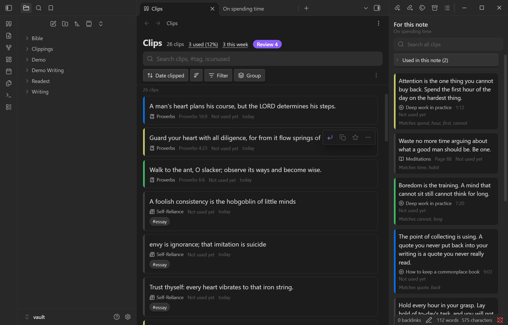
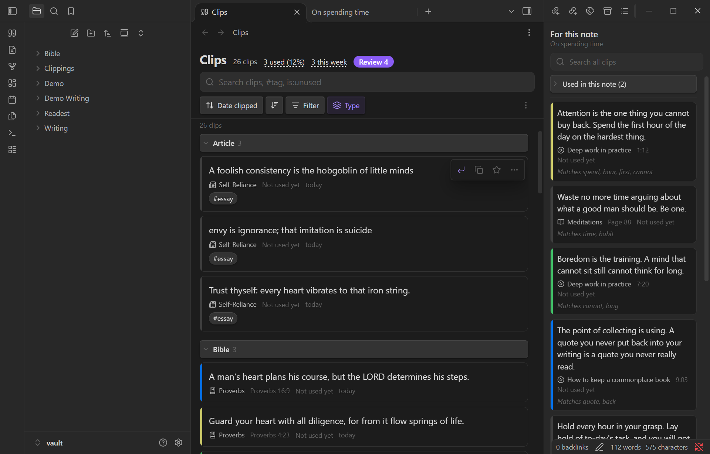

# Obsi Clips

Use the clips you save. Obsi Clips reads the highlights in your vault and puts the right ones next to the note you are writing. It counts how often you use each clip and where. Each day it brings back a few clips you forgot.

It works with the clips from ObsiTube, ObsiRead, ObsiLearn, Obsi Bible, Readest, the Obsidian Web Clipper and any `==marked==` text. It works on desktop, phones and tablets.



## Start

1. Install and turn on the plugin.
2. A short setup opens. It finds the folders that hold clips and shows how many clips each one has. Tick the folders you want and press **Use these folders**.
3. The library opens. The side bar on the right shows **Clips for this note**.

You can change the folders at any time in **Settings → Obsi Clips → Clip folders**, or run **Pick clip folders** again.

### On a phone or tablet

1. Install the plugin from **Settings → Community plugins** on the phone, or sync the plugin folder from your computer.
2. The same setup opens on first start.
3. Open the library from the ribbon (the quote icon) or the command palette.
4. **Clips for this note** sits in the right side bar. Swipe from the right edge to open it.

All buttons on a phone are big enough to tap. Card buttons are always visible, not only on hover.

## What it does

### Clips for this note

The side bar reads the note you are writing and shows the clips that fit it. Each clip says why it fits, like *Matches time, habit*. Clips you already used in this note are in their own list at the top.

- Tap the arrow to put a clip in at the cursor.
- On desktop, drag a clip into the note.
- Type in the search box to look through all clips.
- Select text in a note, right-click and pick **Find clips like this** to search with it.

When the open note is a clip note (a book, video or article), the side bar shows the clips in that note instead.


### Put a clip in

Run **Put a clip in this note**, or right-click in a note and pick **Put a clip here**. Type a few letters. The search finds exact words first, then the start of words, then small typos.

- **Enter** puts it in as a quote with a link back to where it came from.
- **Shift+Enter** puts it in as an embed, so it stays linked to the clip.
- **Ctrl+Enter** (Cmd on a Mac) copies it.

A quote looks like this:

```markdown
> [!quote] [[Letters from a Stoic]] · Page 4
> Nothing, Lucilius, is ours, except time.
```

For a video clip, the time is a link that opens the video at that second.


### Times used

Each clip shows how often it is used: **Used 2×**. Tap it to see each note that uses it and open one.

A clip counts as used when a note:

- embeds it (`![[Book#^clip-abc123]]`),
- links to its block (`[[Book#^clip-abc123]]`), or
- has the clip text pasted in (turn this off in **Counting uses**).

Notes inside your clip folders do not count, so two books that share a quote do not count as uses of each other. Add more folders to ignore, like templates, in **Counting uses**.

In your clip notes, each used clip shows a small **Used 3×** at its end, in both editing and reading view. Turn it off in **Counting uses**.

### The library

Every clip in one place.

- **Search** with words, `#tag`, `is:unused`, `is:used`, `is:starred`, `is:archived`, `is:noted`, `color:green` or `type:book`.
- **Sort** by best match, date clipped, times used, last used, source, length, colour or shuffle.
- **Reverse** any sort with the arrow button next to it.
- **Filter** by type, colour, used or not, starred or archived, has your note, date clipped, tags and sources. The button shows how many clips match before you close it. Each filter shows as a chip you can remove. **Clear all** removes them all.
- **Group** by source, type, tag, month clipped, colour or used or not. Tap a group to fold it.
- **Select** many clips to star, tag, copy or archive them together.
- The numbers at the top are buttons: **9 used** shows the used clips, **3 this week** shows the new ones.

The library remembers your search, sort and filters.

With the keyboard: `/` goes to search, arrow keys or `j` and `k` move between clips. On a clip: `Enter` puts it in, `Shift+Enter` embeds it, `c` copies, `o` opens where it came from, `s` stars, `u` shows where it is used.




### Review

Each day, a few clips you have not used yet. Clips that were never shown come first.

- **Put in a note** (`U`) puts it in the last note you wrote in.
- **Keep** (`K`) brings it back later: in 7 days, then 21, 60 and 180.
- **Star** (`S`) and **Archive** (`A`).

The status bar shows how many are left. A short notice reminds you once a day. Turn both off in **Review**.


### Tidy

Run **Tidy clips** to find:

- **In two notes**: the same words saved twice. They count as one clip.
- **Near copies**: clips that say almost the same thing.
- **No tags**: clips with no tags. Add tags here.
- **Broken links**: embeds and links that point to a clip that is gone.

Tidy never changes your notes by itself. It shows you the clip and opens the note.

## Clip formats it reads

| From | What it looks like |
|---|---|
| ObsiTube, ObsiLearn | A `>` quote with a marked line and a time link under it |
| ObsiRead | A `>` quote with a marked line and a link to the article |
| Obsi Bible | A `### Book 4:23 · BSB · Yellow` heading with a `>` quote |
| Readest | A list item with the highlight and `*page 12*`, and an optional `**Note:**` |
| Web Clipper and others | Any `==marked==` text inside a paragraph or a quote |

Plain `>` quotes with no marks can count too. Turn on **Plain quotes count** in **Clip folders**.

Your own note under a clip (the paragraph after an ObsiTube or ObsiRead quote, or Readest's **Note:**) shows under the clip.

## AI (optional)

AI is off until you set it up. Everything above works without it.

When it is on, it does two small things:

- **Close in meaning.** Search and **Clips for this note** also find clips that mean the same thing with other words. These come after the exact matches, under their own heading.
- **Tag ideas.** In a clip's tags, it suggests tags. It reuses your own tags where it can.

To turn it on, open **Settings → Obsi Clips → AI service**, pick a service (OpenRouter, OpenAI, Groq, Ollama or your own address), add a key and press **Test**.

The key is kept in Obsidian's key store on this device. It is never in the plugin's `data.json`, so it does not go into your vault or your sync. The plugin sends only short pieces: a clip's text, or the first part of the note you are writing. Results are kept so the same question is not asked twice.

With Ollama, nothing leaves your computer.

## Things to know

- **Embeds add a block id.** Putting a clip in as an embed adds a short id like `^clip-abc123` to the end of that clip in its note. If an app writes that note again from scratch, it can remove the id and the embed breaks. Obsi Bible notes are written over by the app, so Obsi Clips puts Bible clips in as quotes, not embeds. **Tidy → Broken links** finds any embed that broke.
- **The plugin never changes your clip notes**, except to add that block id when you choose an embed.
- **The first count takes a moment** in a big vault. After that, only changed notes are read again.
- Star, archive, review and tags you add in the plugin are kept in the plugin's own data. Tags in your notes stay in your notes.

## Settings

- **Clip folders**: which folders hold clips, marked text, plain quotes, and the shortest clip to count.
- **Putting clips in**: quote, embed or plain text, the callout type, and whether to add your note and where it came from.
- **Counting uses**: pasted text counts or not, folders to ignore, and the **Used 3×** marks.
- **Review**: how many clips a day, the daily notice and the status bar.
- **Side bar**: how many clips it shows, and whether it opens when Obsidian starts.
- **AI service**: see above.

## Install by hand

Download `main.js`, `manifest.json` and `styles.css` from the [latest release](https://github.com/Virus7976/Obsi-Clips/releases/latest). Put them in `<your vault>/.obsidian/plugins/obsi-clips/`. Turn the plugin on in **Settings → Community plugins**.

## Build

```bash
npm install
npm run build
npm test
npm run lint
```

## License

MIT
